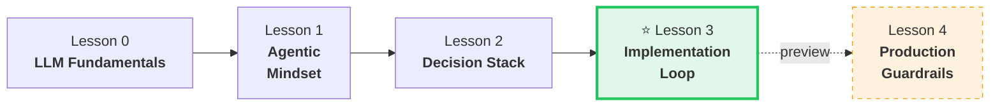
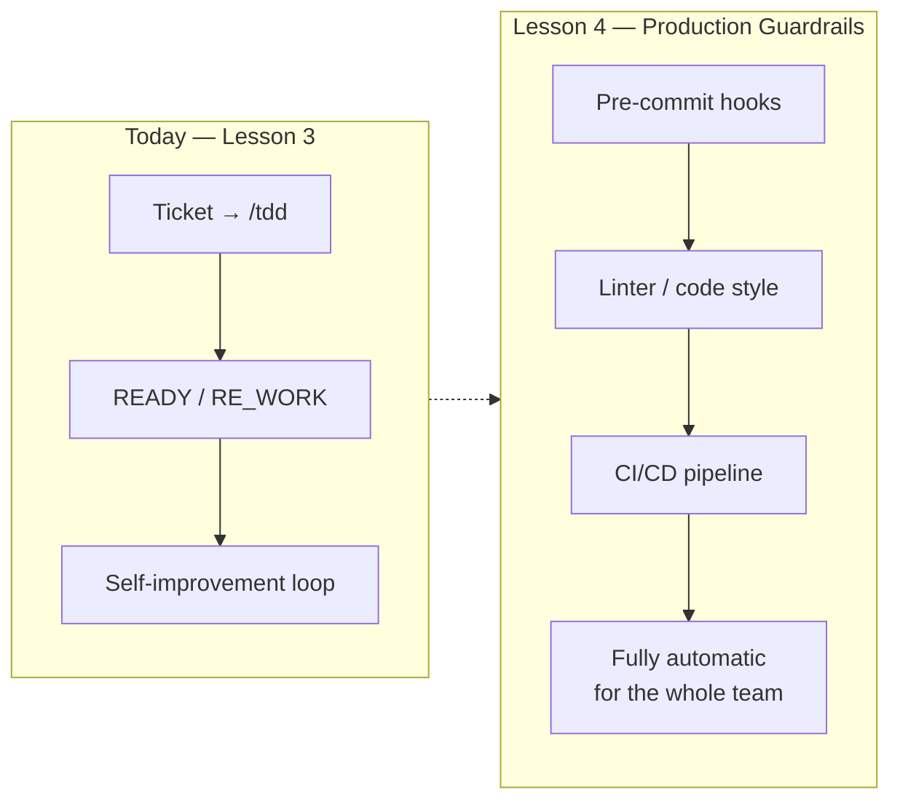
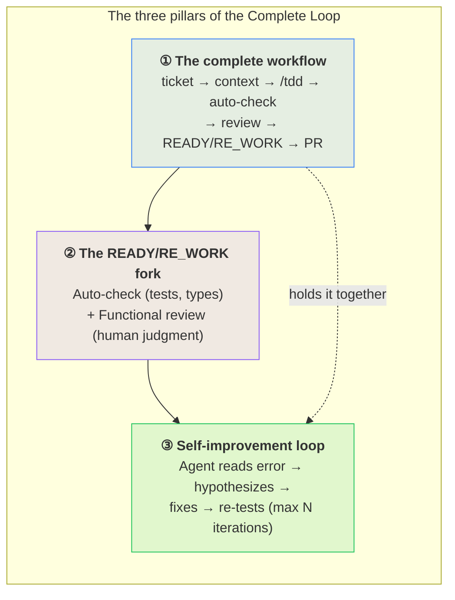
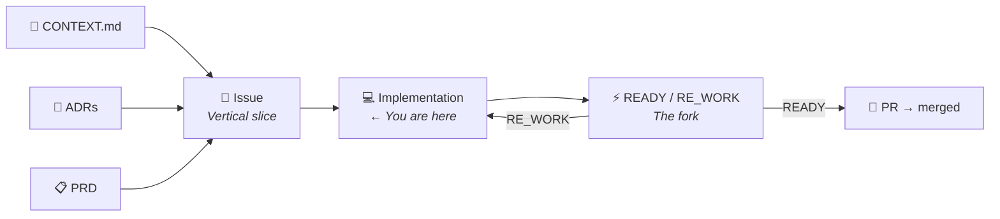
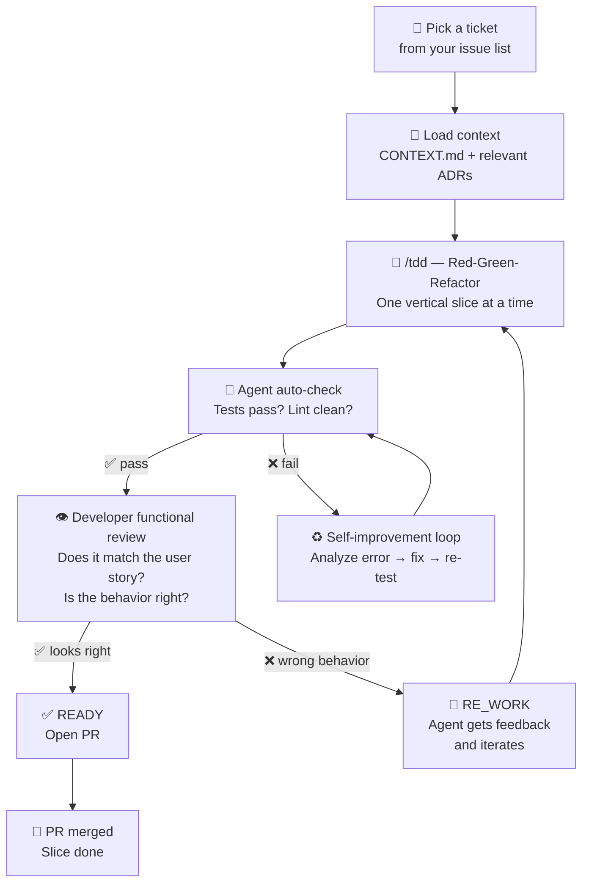
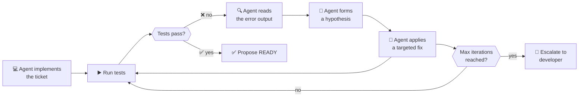
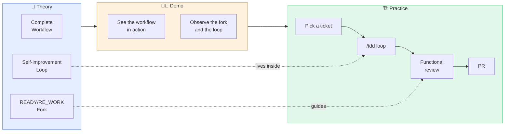
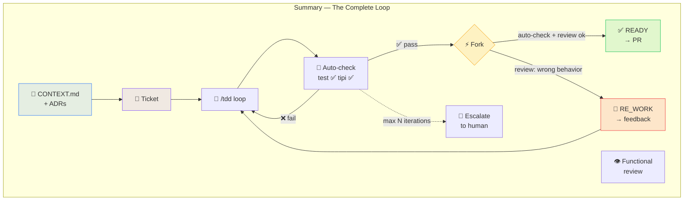

# The Complete Loop
## From Ticket to Code

<div class="abs-br m-6 flex gap-2">
  <span class="text-sm opacity-50">Agentic Engineering Course — Lesson 3</span>
</div>

---
layout: center
class: text-center
zoom: 0.85
---

# Our Learning Journey

<div class="mt-6">



</div>

<div class="mt-4 grid grid-cols-4 gap-2 text-xs">

<div class="p-2 rounded bg-gray-500/10">
<b>Understand</b> how LLMs and the agent harness work
</div>

<div v-click class="p-2 rounded bg-blue-500/10">
<b>Delegate</b> with the 6 principles, co-decompose problems with AI
</div>

<div v-click class="p-2 rounded bg-purple-500/10">
<b>Plan</b> with ADRs, CONTEXT.md, PRD — decisions before code
</div>

<div v-click class="p-2 rounded bg-green-500/10 border border-green-500/50">
<b>Implement</b> ticket → code → PR with the READY/RE_WORK loop
</div>

</div>

---
layout: default
zoom: 0.9
---

# What We've Learned — Lessons 0–2

<div class="grid grid-cols-3 gap-4 mt-6">

<div class="p-4 bg-gray-500/10 rounded-lg border border-gray-500/30">

### 🧠 Lesson 0 — LLM Fundamentals

<div class="text-sm mt-3 space-y-2">

<div v-click class="p-2 bg-gray-500/10 rounded">
<b>Know:</b> tokenization, context windows, statistical nature of generated code
</div>
<div v-click class="p-2 bg-gray-500/10 rounded">
<b>Know:</b> what an AI agent is, LLM vs agent difference, the harness problem
</div>
<div v-click class="p-2 bg-gray-500/10 rounded">
<b>Know:</b> harness architecture — execution, tools, context, safety
</div>

</div>

</div>

<div v-click class="p-4 bg-blue-500/10 rounded-lg border border-blue-500/30">

### 🧠 Lesson 1 — Agentic Mindset

<div class="text-sm mt-3 space-y-2">

<div v-click class="p-2 bg-blue-500/10 rounded">
<b>Know:</b> the 6 delegation workflow principles — AI is not a chatbot but an operating engineer
</div>
<div v-click class="p-2 bg-blue-500/10 rounded">
<b>Know:</b> co-decomposition — how to break down a problem together with the agent
</div>
<div v-click class="p-2 bg-blue-500/10 rounded">
<b>Know:</b> structured prompt engineering, context as specification
</div>

</div>

</div>

<div v-click class="p-4 bg-purple-500/10 rounded-lg border border-purple-500/30">

### 🧠 Lesson 2 — The Decision Stack

<div class="text-sm mt-3 space-y-2">

<div v-click class="p-2 bg-purple-500/10 rounded">
<b>Know:</b> ADRs — recording architectural decisions before coding
</div>
<div v-click class="p-2 bg-purple-500/10 rounded">
<b>Know:</b> CONTEXT.md — domain glossary for shared language
</div>
<div v-click class="p-2 bg-purple-500/10 rounded">
<b>Know:</b> PRD and issues — progressive abstraction from domain to code
</div>

</div>

</div>

</div>

<div class="mt-6 p-3 bg-yellow-500/10 rounded-lg border border-yellow-500/30 text-xs text-center">
<b>Thread:</b> "how it works" → "how to delegate" → "how to plan" → today: <b>"how to implement"</b>
</div>

---
layout: default
zoom: 0.9
---

# Today — Learning Objectives

<div class="mt-6 grid grid-cols-2 gap-6">

<div class="p-5 bg-green-500/10 rounded-xl border border-green-500/30">
<div class="text-2xl mb-2">🎯</div>

### Execute
the complete workflow

<div class="text-sm mt-3 space-y-2">

<div class="p-2 bg-green-500/10 rounded">
<b>1.</b> From a ticket to working code — load context, start /tdd, observe the loop
</div>

<div class="p-2 bg-green-500/10 rounded">
<b>2.</b> Apply the <b>READY / RE_WORK</b> fork: objective auto-check (tests) + functional review (human judgment)
</div>

<div class="p-2 bg-green-500/10 rounded">
<b>3.</b> Know when to let the agent self-correct (self-improvement loop) and when to intervene
</div>

</div>

</div>

<div v-click class="p-5 bg-purple-500/10 rounded-xl border border-purple-500/30">
<div class="text-2xl mb-2">🔬</div>

### Distinguish
agent work from human work

<div class="text-sm mt-3 space-y-2">

<div class="p-2 bg-purple-500/10 rounded">
<b>4.</b> <b>Agent:</b> writes tests, implements, self-corrects on failures — mechanical loop
</div>

<div class="p-2 bg-purple-500/10 rounded">
<b>5.</b> <b>Human:</b> judges whether the solution solves the user story, respects domain language and ADRs
</div>

<div class="p-2 bg-purple-500/10 rounded">
<b>6.</b> Tests are not enough — "tests pass" ≠ "it's READY". Functional review is required.
</div>

</div>

</div>

</div>

<div class="mt-6 p-3 bg-yellow-500/10 rounded-lg border border-yellow-500/30 text-xs text-center">
<b><span class="text-lg">📌</span> By the end of this lesson you'll close the loop:</b> from Decision Stack to working, reviewed code — with the agent as a collaborator.
</div>

---
layout: default
zoom: 0.9
---

# Next Lesson — Preview

<div class="mt-6">



</div>

<div class="mt-4 grid grid-cols-3 gap-4 text-sm">

<div class="p-3 bg-orange-500/10 rounded-lg border border-orange-500/30 text-center">
<div class="text-2xl mb-1">🪝</div>
<b>Pre-commit hooks</b>
<div class="text-xs mt-1 opacity-70">Formatting, linting, quick tests — blocked before the commit</div>
</div>

<div v-click class="p-3 bg-orange-500/10 rounded-lg border border-orange-500/30 text-center">
<div class="text-2xl mb-1">📏</div>
<b>Linter server</b>
<div class="text-xs mt-1 opacity-70">Consistent rules across the team, zero debates</div>
</div>

<div v-click class="p-3 bg-orange-500/10 rounded-lg border border-orange-500/30 text-center">
<div class="text-2xl mb-1">🏗️</div>
<b>CI/CD</b>
<div class="text-xs mt-1 opacity-70">The gate that lets nothing broken through</div>
</div>

</div>

<div class="mt-6 text-center text-sm opacity-70">
  <b>Learning objective:</b> move from the individual loop (you + agent) to team guarantees — <i>automatic, every commit, for everyone.</i>
</div>

---
layout: default
---

# Lesson Agenda

<div class="grid grid-cols-2 gap-4 mt-8">

<div class="p-4 bg-blue-500/10 rounded-lg border border-blue-500/30">

### 🧠 Theory + Demo — 30 min

The **complete agentic workflow**:
from issue to working code, the READY/RE_WORK fork, and the self-improvement loop

<div class="mt-3 text-xs opacity-70">
  Live demo by the instructor — then you replicate it
</div>

</div>

<div v-click class="p-4 bg-purple-500/10 rounded-lg border border-purple-500/30">

### 🏗️ Practice — 80 min

Implement one vertical slice from your PRD end-to-end: pick a ticket → implement with `/tdd` → apply the READY/RE_WORK fork → iterate.

</div>

</div>

<div class="mt-6 text-center text-sm opacity-50">
  <b>Prerequisite:</b> Lesson 2 completed — your group's CONTEXT.md, ADRs, PRD, and issues ready.<br/>
  <b>Objective:</b> Close the loop — produce working, reviewed code from a ticket, using the agent as a collaborator, not just a generator.
</div>

---
layout: section
---

# Part 1 — Theory + Live Demo
## The Complete Workflow (30 min)

---
layout: default
zoom: 0.9
---

# The 3 Key Concepts of This Lesson

<div class="mt-4">



</div>

<div class="mt-4 grid grid-cols-3 gap-3 text-xs">

<div class="p-3 bg-blue-500/10 rounded-lg text-center border border-blue-500/30">
<b>Workflow</b> — the sequence from ticket to PR
</div>

<div class="p-3 bg-purple-500/10 rounded-lg text-center border border-purple-500/30">
<b>Fork</b> — what the agent checks vs what you judge
</div>

<div class="p-3 bg-green-500/10 rounded-lg text-center border border-green-500/30">
<b>Loop</b> — how the agent self-corrects
</div>

</div>

---
layout: statement
---

# In Lesson 2 you built the Decision Stack.

<div v-click class="mt-6 text-xl opacity-70">
  CONTEXT.md. ADRs. PRD. Vertical slice issues.
</div>

<div v-click class="mt-8 text-lg">
  Now — what do you actually <b>do</b> with them?
</div>

---
layout: default
zoom: 0.88
---

# The Missing Step

<div class="mt-4">



</div>

<div class="mt-6 grid grid-cols-3 gap-3 text-xs">

<div class="p-3 bg-blue-500/10 rounded-lg text-center">
  <b>Lesson 2 output</b><br/>Decision Stack:<br/>CONTEXT.md + ADRs + PRD + issues
</div>

<div v-click class="p-3 bg-purple-500/10 rounded-lg text-center">
  <b>This lesson</b><br/>Implementation loop:<br/>ticket → code → READY/RE_WORK
</div>

<div v-click class="p-3 bg-green-500/10 rounded-lg text-center">
  <b>Next lessons</b><br/>Production guardrails:<br/>CI/CD, linting, pre-commit
</div>

</div>

---
layout: default
zoom: 0.88
---

# The Full Implementation Workflow

<div class="mt-4">



</div>

<div v-click class="mt-4 text-xs text-center opacity-60">
  <b>The agent handles the mechanical loop.</b> You handle the judgment calls: "does this actually solve the user story?"
</div>

---
layout: default
zoom: 0.88
---

# Live Demo — What the Instructor Will Show

<div class="mt-4 p-4 bg-yellow-500/10 rounded-lg border border-yellow-500/30 text-sm">
  <b>👁️ Watch for:</b> how the instructor loads context, what prompt they use to start the ticket, how the agent self-corrects, and what makes them choose READY vs RE_WORK.
</div>

<div class="mt-4 grid grid-cols-2 gap-4 text-xs">

<div class="p-3 bg-blue-500/10 rounded-lg border border-blue-500/30 space-y-2">

**Step 1 — Load context**
```
"Read CONTEXT.md, docs/adr/*.md, and this issue:
[paste issue content]
Ask me any clarifying questions before starting."
```

</div>

<div v-click class="p-3 bg-blue-500/10 rounded-lg border border-blue-500/30 space-y-2">

**Step 2 — Start the TDD loop**
```
"Implement this slice with /tdd.
One test at a time. Red-green-refactor.
Do not write code before the test fails."
```

</div>

<div v-click class="p-3 bg-blue-500/10 rounded-lg border border-blue-500/30 space-y-2">

**Step 3 — Agent hits a failing test**
```
The agent reads the error output, adjusts the
implementation, re-runs the tests.
Watch how it narrows the hypothesis automatically.
```

</div>

<div v-click class="p-3 bg-blue-500/10 rounded-lg border border-blue-500/30 space-y-2">

**Step 4 — READY/RE_WORK decision**
```
Tests pass. Instructor reads the diff.
"Does this match the user story?"
"Is the behavior correct end-to-end?"
READY → open PR. RE_WORK → give targeted feedback.
```

</div>

</div>

---
layout: default
zoom: 0.88
---

# The READY / RE_WORK Fork — In Detail

<div class="grid grid-cols-2 gap-6 mt-4">

<div>

### 🤖 Agent auto-check (objective)

<div class="text-sm mt-3 space-y-2">

<div class="p-2 bg-blue-500/10 rounded-lg">

**Tests pass?** All tests green — including any existing tests in the codebase.

</div>

<div class="p-2 bg-blue-500/10 rounded-lg">

**No regressions?** Existing test suite still green.

</div>

<div class="p-2 bg-blue-500/10 rounded-lg">

**Types compile?** No TypeScript errors, no obvious static analysis failures.

</div>

<div v-click class="mt-2 p-2 bg-green-500/10 rounded-lg text-xs">

If all three pass → the agent proposes READY. The developer still reviews.

</div>

</div>

</div>

<div v-click>

### 👁️ Developer functional review (judgment)

<div class="text-sm mt-3 space-y-2">

<div class="p-2 bg-purple-500/10 rounded-lg">

**Does it match the user story?** Read the issue. Does the implementation actually solve the problem described?

</div>

<div class="p-2 bg-purple-500/10 rounded-lg">

**Is the behavior correct?** Run it mentally or actually. Does it do what a user would expect?

</div>

<div class="p-2 bg-purple-500/10 rounded-lg">

**Is the domain language respected?** Check variable names, function names — do they match CONTEXT.md?

</div>

<div v-click class="mt-2 p-2 bg-yellow-500/10 rounded-lg text-xs">

This is the judgment the agent cannot make. <b>You own this check.</b>

</div>

</div>

</div>

</div>

<div v-click class="mt-4 p-3 bg-gray-500/10 rounded-lg border border-gray-500/30 text-xs text-center">
  <b>Both checks are required.</b> Auto-check is necessary but not sufficient — tests prove the code runs, not that it does the right thing.<br/>
  Functional review is necessary but not sufficient — intuition misses regressions that tests catch.
</div>

---
layout: default
zoom: 0.87
---

# Tests as the Feedback System

<div class="grid grid-cols-2 gap-6 mt-4">

<div>

### Why tests close the loop

<div class="text-sm mt-3 space-y-2">

<div class="p-2 bg-blue-500/10 rounded-lg">

A test is a **machine-checkable specification** of one behavior. When the agent gets feedback through a test failure, it gets a precise, unambiguous signal — not a vague correction.

</div>

<div v-click class="p-2 bg-blue-500/10 rounded-lg">

**Without tests**, RE_WORK means: "I told the agent in natural language that something was wrong, it regenerated code, I checked again manually."

</div>

<div v-click class="p-2 bg-green-500/10 rounded-lg">

**With tests**, RE_WORK means: "the test says exactly what's wrong, the agent fixes it, the test confirms it's fixed." No human in the loop for that cycle.

</div>

</div>

</div>

<div v-click>

### Integration tests vs E2E

<div class="text-sm mt-3 space-y-2">

<div class="p-2 bg-purple-500/10 rounded-lg">

**Unit test:** function X returns Y. Fast, cheap, but misses integration bugs. Agent produces these easily.

</div>

<div class="p-2 bg-purple-500/10 rounded-lg">

**Integration test:** the database, API, and business logic work together. Catches the bugs that unit tests can't. This is the minimum for READY.

</div>

<div class="p-2 bg-purple-500/10 rounded-lg">

**E2E test:** the full user journey works — from HTTP request to database to response. The gold standard for READY.

</div>

</div>

<div v-click class="mt-3 p-2 bg-yellow-500/10 rounded-lg text-xs">

<b>Practical rule:</b> one integration test per vertical slice. It doesn't have to be perfect — it just has to fail when the behavior is wrong.

</div>

</div>

</div>

<div class="mt-2 text-right text-[10px] opacity-35">
📚 <em>Rif.:</em> Integration Testing — Kent Beck, 2002 &nbsp;|&nbsp; Testing Trophy — Kent C. Dodds, 2018
</div>

---
layout: default
zoom: 0.87
---

# The Self-Improvement Loop

<div class="mt-2">



</div>

<div class="mt-4 grid grid-cols-3 gap-3 text-xs">

<div v-click class="p-3 bg-blue-500/10 rounded-lg border border-blue-500/30">

**What the agent does autonomously:**
- Reads the test failure output
- Identifies the specific assertion that failed
- Narrows down to the relevant code
- Applies a minimal fix
- Re-runs the suite

</div>

<div v-click class="p-3 bg-yellow-500/10 rounded-lg border border-yellow-500/30">

**The guardrails:**
- Maximum N iterations (3–5 is typical)
- Scope: only touch files related to the current issue
- If the fix requires changing an ADR-governed decision → escalate immediately

</div>

<div v-click class="p-3 bg-red-500/10 rounded-lg border border-red-500/30">

**When to escalate to human:**
- Max iterations reached and tests still fail
- The agent wants to change architecture (not just implementation)
- A fix in module A keeps breaking module B

</div>

</div>

---
layout: default
zoom: 0.9
---

# Putting It Together — Workflow Summary

<div class="mt-4 grid grid-cols-2 gap-4">

<div class="p-4 bg-blue-500/10 rounded-lg border border-blue-500/30">

### The developer's job

<div class="text-sm mt-3 space-y-1">

1. **Pick a ticket** and load the right context
2. **Start the TDD loop** with a clear prompt
3. **Watch the auto-check** — let the agent run its self-improvement loop
4. **Do the functional review** — this is YOUR judgment, not the agent's
5. **Decide READY or RE_WORK** — give precise feedback if RE_WORK
6. **Open the PR** when READY

</div>

</div>

<div v-click class="p-4 bg-purple-500/10 rounded-lg border border-purple-500/30">

### The agent's job

<div class="text-sm mt-3 space-y-1">

1. **Read the context** — CONTEXT.md, ADRs, issue
2. **Ask clarifying questions** before starting
3. **Write one failing test** at a time (not a suite)
4. **Implement** the minimum code to make it pass
5. **Self-correct** when tests fail — autonomously
6. **Propose READY** when auto-check passes

</div>

</div>

</div>

<div v-click class="mt-4 p-3 bg-yellow-500/10 rounded-lg border border-yellow-500/30 text-xs text-center">
  <b>The division of labor is clear:</b> the agent handles the mechanical loop. You handle the judgment.<br/>
  Confusing the two — asking the agent for judgment, or doing the loop manually — is where most teams lose the efficiency gain.
</div>

---
layout: default
zoom: 0.9
---

# From Theory to Practice — Concept Map

<div class="mt-4">



</div>

<div class="mt-4 text-xs text-center opacity-60">
  Theory provides the concepts → the demo shows them in action → you apply them in practice.
</div>

---
layout: section
---

# Part 2 — Practice
## Implement One Ticket End-to-End (80 min)

---
layout: default
zoom: 0.88
---

# The Exercise — Your Turn

<div class="mt-4">

<div class="flex items-center gap-2 text-xs justify-center flex-wrap">

<div class="p-3 bg-gray-500/10 rounded-lg border border-gray-500/30 text-center w-36">
<div class="text-xl mb-1">📌</div>
<b>Pick a ticket</b>
<div class="mt-1 opacity-70">From your issue list<br/>(Lesson 2 output)</div>
</div>

<span class="text-xl opacity-40">→</span>

<div v-click class="p-3 bg-gray-500/10 rounded-lg border border-gray-500/30 text-center w-36">
<div class="text-xl mb-1">📂</div>
<b>Load context</b>
<div class="mt-1 opacity-70">CONTEXT.md<br/>+ relevant ADRs</div>
</div>

<span v-click class="text-xl opacity-40">→</span>

<div v-click class="p-3 bg-gray-500/10 rounded-lg border border-gray-500/30 text-center w-36">
<div class="text-xl mb-1">🔴</div>
<b>/tdd loop</b>
<div class="mt-1 opacity-70">One test at a time.<br/>Let the agent self-correct.</div>
</div>

<span v-click class="text-xl opacity-40">→</span>

<div v-click class="p-3 bg-gray-500/10 rounded-lg border border-gray-500/30 text-center w-36">
<div class="text-xl mb-1">⚡</div>
<b>READY / RE_WORK</b>
<div class="mt-1 opacity-70">Auto-check<br/>+ functional review</div>
</div>

<span v-click class="text-xl opacity-40">→</span>

<div v-click class="p-3 bg-gray-500/10 rounded-lg border border-gray-500/30 text-center w-36">
<div class="text-xl mb-1">🚀</div>
<b>PR</b>
<div class="mt-1 opacity-70">Open a PR<br/>with the result</div>
</div>

</div>

<div v-click class="mt-6 p-3 bg-yellow-500/10 rounded-lg border border-yellow-500/30 text-xs text-center">
  <b>⚠️ Rule:</b> the agent implements; you review. Do not write code directly.<br/>
  If the agent gets stuck: give it precise, targeted feedback — not a rewrite instruction.
</div>

</div>

---
layout: default
zoom: 0.87
---

# Choosing Your Ticket — Criteria

<div class="mt-4 grid grid-cols-2 gap-4">

<div>

### ✅ Good ticket for this exercise

<div class="text-sm mt-3 space-y-2">

<div class="p-2 bg-green-500/10 rounded-lg">

**Small, well-defined scope.** One user story. One API endpoint or one UI interaction.

</div>

<div class="p-2 bg-green-500/10 rounded-lg">

**Has a clear acceptance criterion** — you can tell unambiguously if it's done.

</div>

<div class="p-2 bg-green-500/10 rounded-lg">

**Doesn't depend on other unimplemented slices.** It can be run and tested in isolation.

</div>

<div class="p-2 bg-green-500/10 rounded-lg text-xs">

**Example:** "Organizer creates a proposal with time slots" — clear scope, single endpoint, testable alone.

</div>

</div>

</div>

<div v-click>

### ❌ Avoid for this exercise

<div class="text-sm mt-3 space-y-2">

<div class="p-2 bg-red-500/10 rounded-lg">

**"Full app" tickets.** Too broad — the agent will produce too much code to review properly.

</div>

<div class="p-2 bg-red-500/10 rounded-lg">

**Integration tickets.** "Connect consensus detection to Google Calendar" — depends on many other parts.

</div>

<div class="p-2 bg-red-500/10 rounded-lg">

**Vague tickets.** "Improve the voting flow" — no clear done criterion → no clear READY criterion.

</div>

</div>

</div>

</div>

<div v-click class="mt-4 p-3 bg-blue-500/10 rounded-lg border border-blue-500/30 text-xs text-center">
  If your issue list doesn't have a good ticket, ask the agent to refine one:<br/><i>"Split this issue into two independent slices. Each should be testable on its own."</i>
</div>

---
layout: default
zoom: 0.87
---

# The Starter Prompt — Copy and Adapt

<div class="mt-4">

```markdown
Context files to read first:
- docs/CONTEXT.md (domain glossary — use these names everywhere)
- docs/adr/*.md (architecture decisions — respect them)

Issue to implement:
[paste the full issue content here]

Instructions:
- Use /tdd: write one failing test before any code
- Implement the minimum code to make each test pass
- Refactor after each green test before moving to the next
- Run the full test suite after each cycle
- If tests fail, analyze the error and fix it autonomously (max 4 attempts)
- When all tests pass, summarize what you built and propose READY
- Do not implement anything outside the scope of this issue
```

<div class="mt-4 grid grid-cols-3 gap-2 text-xs">

<div v-click class="p-2 bg-blue-500/10 rounded text-center">
<b>Why load CONTEXT.md first?</b><br/>Without it, the agent uses generic names. Within 20 lines it's already drifted from the domain glossary.
</div>

<div v-click class="p-2 bg-blue-500/10 rounded text-center">
<b>Why "max 4 attempts"?</b><br/>Without a limit, the agent can spiral — making increasingly speculative fixes. 4 cycles is enough for real bugs; more usually means a design issue.
</div>

<div v-click class="p-2 bg-blue-500/10 rounded text-center">
<b>Why "propose READY"?</b><br/>Forces the agent to explicitly signal completion. Prevents it from quietly moving on to the next thing without your review.
</div>

</div>

</div>

---
layout: default
zoom: 0.9
---

# Functional Review — Your Checklist

<div class="mt-4">

### When the agent proposes READY, ask yourself:

<div class="grid grid-cols-2 gap-4 mt-4 text-sm">

<div class="space-y-2">

<div class="p-2 bg-gray-500/10 rounded-lg">

**1. User story check.** Re-read the issue. Does the implementation allow the user to actually do what the story describes?

</div>

<div class="p-2 bg-gray-500/10 rounded-lg">

**2. Happy path check.** Mentally trace the happy path. Is the behavior correct end-to-end?

</div>

<div class="p-2 bg-gray-500/10 rounded-lg">

**3. Edge case check.** What happens with an empty list? A duplicate vote? A missing organizer? Does the code handle it gracefully?

</div>

</div>

<div v-click class="space-y-2">

<div class="p-2 bg-gray-500/10 rounded-lg">

**4. Domain language check.** Are function names, variable names, and error messages in the language of CONTEXT.md?

</div>

<div class="p-2 bg-gray-500/10 rounded-lg">

**5. ADR compliance check.** Does the implementation respect the architecture decisions? (auth strategy, data storage, etc.)

</div>

<div class="p-2 bg-gray-500/10 rounded-lg">

**6. Scope check.** Did the agent only touch files related to this issue? Or did it refactor unrelated code "while it was there"?

</div>

</div>

</div>

<div v-click class="mt-4 p-3 bg-yellow-500/10 rounded-lg border border-yellow-500/30 text-xs text-center">
  <b>If anything fails the checklist:</b> don't rewrite the prompt from scratch. Give targeted feedback:<br/>
  <i>"The vote acceptance criterion in the issue says X. The current implementation does Y. Fix only that."</i>
</div>

</div>

---
layout: default
zoom: 0.88
---

# Timing Guide — 80 min

<div class="mt-4 space-y-3">

<div class="p-4 bg-gray-500/10 rounded-lg border border-gray-500/30">
<div class="flex gap-3 items-start">
<div class="text-sm font-bold w-20 shrink-0 opacity-60">0–10 min</div>
<div class="text-sm"><b>Pick & prepare.</b> Each group picks a ticket, reads it carefully, identifies the relevant ADRs, and prepares the starter prompt. Don't rush this — a clear prompt saves 20 minutes of RE_WORK.</div>
</div>
</div>

<div v-click class="p-4 bg-gray-500/10 rounded-lg border border-gray-500/30">
<div class="flex gap-3 items-start">
<div class="text-sm font-bold w-20 shrink-0 opacity-60">10–50 min</div>
<div class="text-sm"><b>TDD loop.</b> Run the starter prompt. Observe the agent's self-improvement loop. Intervene only if the agent is stuck or going off-scope. Let it reach "propose READY" on its own.</div>
</div>
</div>

<div v-click class="p-4 bg-gray-500/10 rounded-lg border border-gray-500/30">
<div class="flex gap-3 items-start">
<div class="text-sm font-bold w-20 shrink-0 opacity-60">50–65 min</div>
<div class="text-sm"><b>Functional review + READY/RE_WORK.</b> Apply the 6-point checklist. If RE_WORK: write precise targeted feedback, run one more cycle. If READY: open a PR (or commit to a branch).</div>
</div>
</div>

<div v-click class="p-4 bg-yellow-500/10 rounded-lg border border-yellow-500/30">
<div class="flex gap-3 items-start">
<div class="text-sm font-bold w-20 shrink-0 opacity-60">65–80 min</div>
<div class="text-sm"><b>Class debrief.</b> Each group shares: what ticket they picked, how many RE_WORK iterations they needed, what failed the functional review, and one thing they'd do differently.</div>
</div>
</div>

</div>

---
layout: section
---

# Cliffhanger
## You can close the loop. But can your whole team?

---
layout: default
zoom: 0.88
---

# You Now Know How to Ship a Ticket

<div class="mt-6 text-center">

<div class="text-4xl mb-6">🎉</div>

<div class="text-lg">
  You can go from issue to working, reviewed code.<br/>
  The agent implements. The tests verify. You judge.
</div>

<div v-click class="mt-8 text-xl font-bold">
  But what happens when it's not just you?
</div>

</div>

<div v-click class="mt-8 grid grid-cols-3 gap-4 text-sm">

<div class="p-3 bg-red-500/10 rounded-lg border border-red-500/30 text-center">
  A teammate pushes a PR at 11pm.<br/>No functional review.<br/>No domain check.<br/><b>Who catches it?</b>
</div>

<div class="p-3 bg-red-500/10 rounded-lg border border-red-500/30 text-center">
  The agent introduces a name that isn't in CONTEXT.md.<br/>It slips through code review.<br/><b>Who catches it?</b>
</div>

<div class="p-3 bg-red-500/10 rounded-lg border border-red-500/30 text-center">
  The build passes locally.<br/>It fails in staging because of an env difference.<br/><b>Who catches it?</b>
</div>

</div>

<div v-click class="mt-6 p-4 bg-yellow-500/10 rounded-lg border border-yellow-500/30 text-sm text-center">
  The READY/RE_WORK loop only works at the <b>individual</b> level.<br/>
  Production-ready code needs guardrails that work at the <b>team</b> level — automatically, every time, for everyone.
</div>

---
layout: default
zoom: 0.87
---

# Production-Ready Code — The Missing Layer

<div class="mt-6 text-center text-sm opacity-70">
  Everything you've built so far lives in your local loop. Production adds a new set of forces.
</div>

<div class="mt-6 grid grid-cols-3 gap-4 text-xs">

<div v-click class="p-4 bg-blue-500/10 rounded-lg border border-blue-500/30 text-center">
  <div class="text-3xl mb-3">🪝</div>
  <b>Pre-commit hooks</b>
  <div class="mt-2 opacity-70">
    Enforced before every commit — locally. Format. Lint. Quick tests. The last line of defense before the code leaves your machine.
  </div>
</div>

<div v-click class="p-4 bg-purple-500/10 rounded-lg border border-purple-500/30 text-center">
  <div class="text-3xl mb-3">📏</div>
  <b>Linter / Code style server</b>
  <div class="mt-2 opacity-70">
    Consistent rules across the team. No manual formatting debates. The agent follows them automatically if they're enforced at the server level.
  </div>
</div>

<div v-click class="p-4 bg-green-500/10 rounded-lg border border-green-500/30 text-center">
  <div class="text-3xl mb-3">🏗️</div>
  <b>CI/CD pipeline</b>
  <div class="mt-2 opacity-70">
    The gate that runs on every PR. Full test suite, build verification, automated checks. Merges nothing that doesn't pass.
  </div>
</div>

</div>

<div v-click class="mt-6 p-4 bg-yellow-500/10 rounded-lg border border-yellow-500/30 text-sm text-center">
  These are <b>team-level guardrails</b> — they don't trust any individual (human or agent) to always do the right thing.<br/>
  They enforce standards automatically, at every commit, for every contributor.
</div>

<div v-click class="mt-4 p-3 bg-gray-500/10 rounded-lg border border-gray-500/30 text-xs text-center">
  <b>Next lesson:</b> we set these up for real — and wire them into the agentic workflow so the agent knows the rules before it writes the first line.
</div>

---
layout: default
zoom: 0.9
---

# Homework — Apply the Loop to Your World

<div class="mt-6">

### The assignment

<div class="mt-4 p-4 bg-blue-500/10 rounded-lg border border-blue-500/30 text-sm">

Take a real task from your professional context — a feature, a bug, a refactor — and run the **full implementation loop** on it:

1. Define the task as a vertical slice (one user story, one done criterion)
2. Write a minimal CONTEXT.md for the domain (5–10 terms)
3. Implement it using `/tdd` and the starter prompt from today
4. Apply the READY/RE_WORK fork — at least one RE_WORK cycle
5. Document: how many iterations did you need? What failed the functional review?

</div>

<div class="mt-4 grid grid-cols-3 gap-3 text-xs">

<div v-click class="p-3 bg-gray-500/10 rounded-lg border border-gray-500/30">

<b>Why your own context?</b><br/>The classroom app has clean requirements. Real work doesn't. The friction points you hit reveal where the method needs adaptation.

</div>

<div v-click class="p-3 bg-gray-500/10 rounded-lg border border-gray-500/30">

<b>What to bring back:</b><br/>One concrete observation — something that worked differently than expected, or a guardrail you had to add.

</div>

<div v-click class="p-3 bg-yellow-500/10 rounded-lg border border-yellow-500/30">

<b>Minimum viable delivery:</b><br/>The CONTEXT.md you wrote + a summary of the READY/RE_WORK loop (how many iterations, what triggered RE_WORK, final result).

</div>

</div>

</div>

---
layout: default
zoom: 0.85
---

# Lesson Summary

<div class="grid grid-cols-2 gap-6 mt-4">

<div>

### Theory — The Complete Loop

<div class="text-sm mt-4 space-y-2">

- **The workflow:** pick ticket → load context → /tdd → auto-check → functional review → READY/RE_WORK → PR
- **READY/RE_WORK fork:** agent auto-checks (tests + types), developer does the functional judgment
- **Tests as feedback:** integration test = machine-checkable spec; no test = no precise feedback
- **Self-improvement loop:** agent reads error → forms hypothesis → applies fix → retries (max N iterations)
- **When to escalate:** max iterations reached, architecture change needed, cross-module spiral

</div>

</div>

<div class="p-4 bg-gray-500/10 rounded-lg border border-gray-500/30">



</div>

</div>

<div class="grid grid-cols-2 gap-6 mt-2">

<div>

### Practice — What You Did

<div class="text-sm mt-4 space-y-2">

- ✅ Loaded context (CONTEXT.md + ADRs) before implementation
- ✅ Used /tdd: one test at a time, one failing test before any code
- ✅ Observed the self-improvement loop — agent self-correcting on test failures
- ✅ Applied the functional review checklist
- ✅ Made a READY or RE_WORK decision with precise feedback
- ✅ Opened a PR (or a clean branch commit)

</div>

<div class="mt-4 p-3 bg-green-500/10 rounded-lg border border-green-500/30 text-sm">

<b>Key result:</b> You closed the loop — from Decision Stack to working, reviewed code — with the agent as a collaborator, not just a generator.

</div>

</div>

</div>

---
layout: center
class: text-center
---

<div class="mb-8">
  <div class="text-7xl font-bold bg-gradient-to-r from-blue-400 via-purple-400 to-pink-400 bg-clip-text text-transparent">
    Questions?
  </div>
</div>

<div class="mt-8 text-lg opacity-70 max-w-2xl mx-auto">
  "Make it work, make it right, make it fast."
</div>

<div class="mt-4 text-sm opacity-50">
  — Kent Beck
</div>

---
layout: center
class: text-center
---

<div class="mb-8">
  <div class="text-6xl font-bold bg-gradient-to-r from-blue-400 via-green-400 to-purple-400 bg-clip-text text-transparent">
    Ship it.
  </div>
</div>

<div class="mt-8 text-sm opacity-50">
  Lesson 3 — Agentic Engineering Module
</div>
